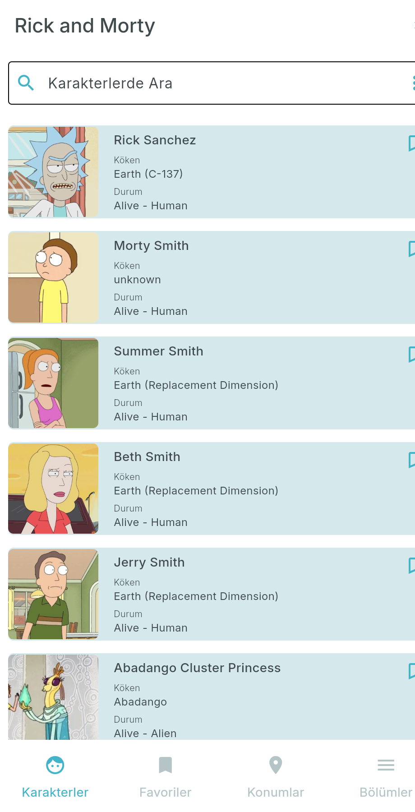
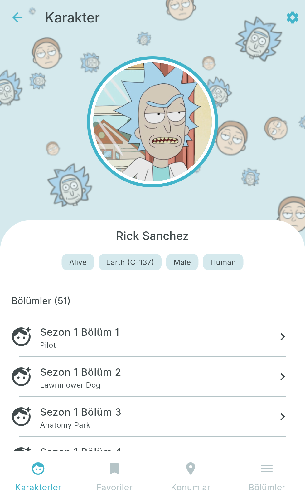
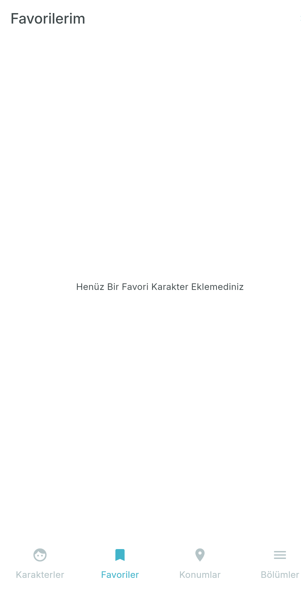
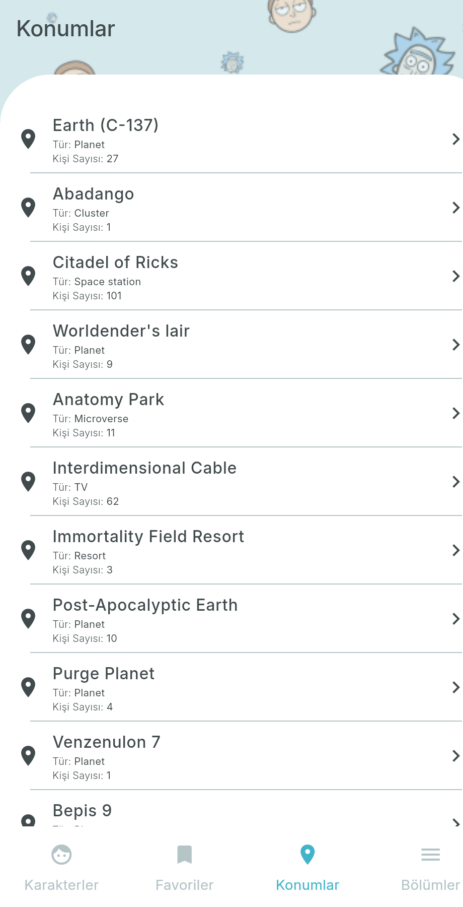
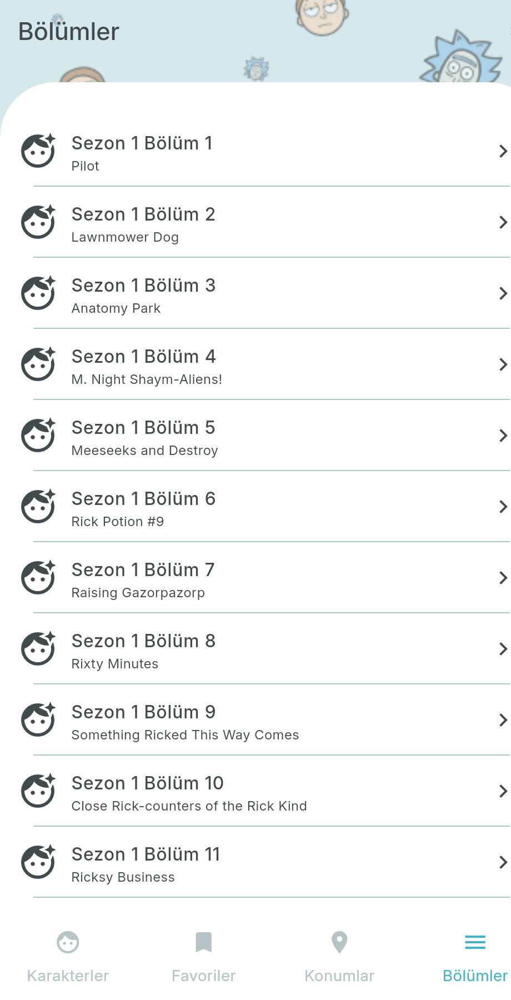
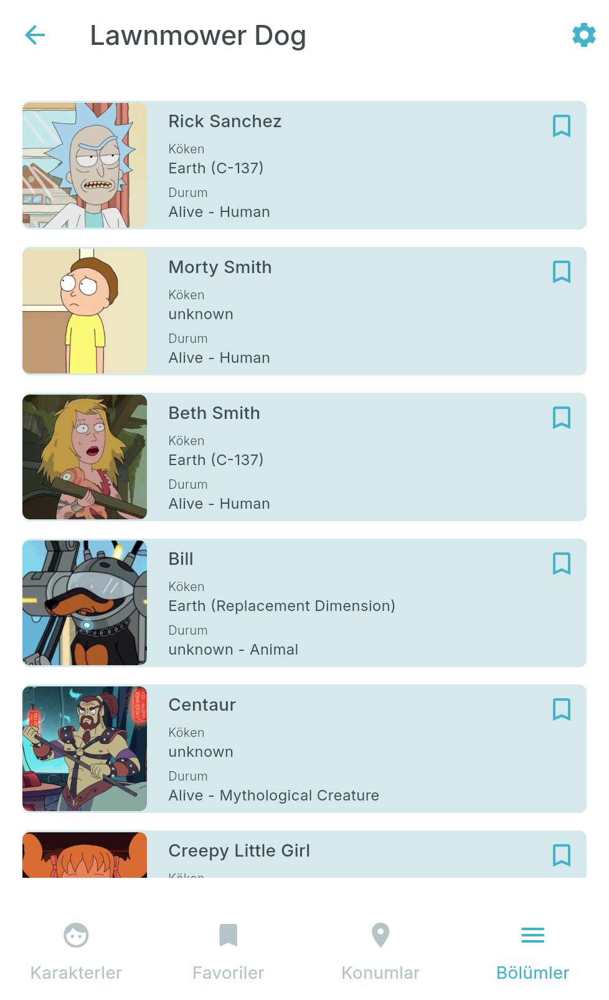
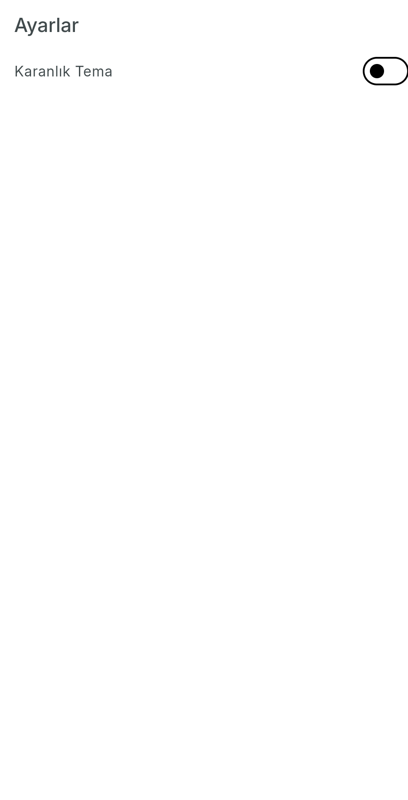

# Rick and Morty

Flutter ile yazılmış bir Rick and Morty rehberi. Uygulama, [Rick and Morty API](https://rickandmortyapi.com/) üzerinden karakterleri, yaşadıkları konumları ve dizinin bölümlerini listeler. Arayüz Türkçedir; açık ve koyu tema desteklenir. Favoriye alınan karakterler cihazda saklanır.

## Ekran görüntüleri

| Karakterler | Karakter detayı | Favoriler |
| --- | --- | --- |
|  |  |  |

| Konumlar | Bölümler | Bölüm kadrosu |
| --- | --- | --- |
|  |  |  |

| Ayarlar | Karanlık tema |
| --- | --- |
|  |  |

## Ne yapar?

Alt menüde dört ana sekme vardır. Ayarlar, üst çubuktaki dişli simgesinden açılır ve sekmenin dışında durur; geri dönünce kaldığınız sekme korunur.

### Karakterler

Ana sayfa dizideki karakterleri kartlar halinde listeler. Her kartta portre, ad, köken ve durum (örneğin `Alive - Human`) görünür. Listenin sonuna yaklaşınca bir sonraki sayfa otomatik yüklenir.

- Arama kutusuna bir ad yazıp arama tuşuna basınca liste o ada göre süzülür.
- Sağdaki menüden durum filtresi seçilir. Seçenekler API'nin beklediği değerlerdir: `all`, `alive`, `dead`, `unknown`.
- Yer imi simgesi karakteri favorilere ekler veya favorilerden çıkarır.
- Karta dokununca karakter sayfası açılır.

### Karakter detayı

Sayfanın üstünde karakter portresi, altta adı ve dört etiket vardır: durum, köken, cinsiyet ve tür. Altta o karakterin yer aldığı bölümler listelenir. Bölüm sayısı başlıkta gösterilir.

### Favoriler

Favori kimlikleri `SharedPreferences` ile cihazda tutulur. Sekme açılınca bu kimlikler API'den toplu çekilir ve aynı kart düzeniyle gösterilir. Henüz favori yoksa "Henüz Bir Favori Karakter Eklemediniz" yazar. Uygulama kapanıp açılsa da liste durur.

### Konumlar

Konum adı, türü (gezegen, uzay istasyonu, mikro evren gibi) ve orada kayıtlı kişi sayısı listelenir. Liste aşağı kaydırıldıkça yeni sayfa yüklenir. Bir konuma dokununca o konumun sakinleri karakter kartları olarak açılır.

### Bölümler

Bölümler kod ve ad ile listelenir (örneğin `S01E01` / Pilot). Sayfalama karakter ve konum listesindekiyle aynıdır. Bir bölüme dokununca o bölümde görünen karakterler açılır.

### Ayarlar

"Karanlık Tema" anahtarı açık ve koyu palet arasında geçiş yapar. Yazı tipi Inter'dir. Açık temada birincil renk `#42B4CA`, koyu temada zemin `#414A4C` olur.

## Nasıl çalışır?

Ekranlar kendi view model'lerine bağlıdır. View model API'den veriyi alır, `ChangeNotifier` ile ekranı günceller. Servisler `get_it` ile uygulama açılırken bir kez kurulur; ekranlar `locator` üzerinden aynı `ApiService` ve `PreferencesService` örneğini kullanır.

```text
Ekran  →  ViewModel  →  ApiService (Dio)  →  rickandmortyapi.com
                      ↘  PreferencesService  →  SharedPreferences
```

Sayfa geçişleri `go_router` ile yapılır. Dört sekme bir `StatefulShellRoute` içindedir; sekme değişince diğer sekmelerin durumu kaybolmaz. Karakter, sakinler ve bölüm kadrosu sayfaları ilgili kaydı `extra` ile alır, bu yüzden adres çubuğundan doğrudan açılamazlar.

`ApiService` şu çağrıları yapar:

| Metot | Uç nokta | Kullanım |
| --- | --- | --- |
| `getCharacters` | `GET /character` | Liste, arama (`name`) ve durum filtresi (`status`). Sonraki sayfa, API'nin döndürdüğü `info.next` adresiyle istenir. |
| `getMultipleCharacters` | `GET /character/1,2,3` | Favoriler ve bölüm kadrosu. Tek kayıt dizi değil nesne döndüğü için her iki cevap da ele alınır. |
| `getAllEpisodes` | `GET /episode` | Bölüm listesi ve sayfalama. |
| `getMultipleEpisodes` | `GET /episode/1,2,3` | Bir karakterin bölümleri. Adreslerden yalnızca kimlik alınır. |
| `getAllLocations` | `GET /location` | Konum listesi ve sayfalama. |

## Proje yapısı

```text
lib/
  main.dart                         Uygulama girişi, tema sağlayıcısı
  app/
    locator.dart                    get_it kaydı
    router.dart                     Sekmeler ve sayfa yolları
    theme.dart                      Açık / koyu ThemeData
  models/                           API cevaplarının modelleri
  services/
    api_service.dart                HTTP istemcisi
    preferences_service.dart        Favori kimlikleri
  views/
    app_view.dart                   Alt gezinme çubuğu
    screens/                        Her sekme ve detay sayfası + view model
    widgets/                        Ortak kart, app bar, liste ve arka plan
assets/
  fonts/                            Inter
  images/                           Üst şerit arka planı
```

## Çalıştırma

[Flutter](https://docs.flutter.dev/get-started/install) SDK'sı kurulu olmalıdır. Proje Dart `^3.13.0` kullanır.

```bash
flutter pub get
flutter run
```

Bağlı bir telefon, emülatör, Windows, Chrome veya Edge yeterlidir. İnternet gerekir; veri tamamen uzak API'den gelir. Uygulamanın kendi hesabı veya API anahtarı yoktur.

## Kullanılan paketler

| Paket | Görevi |
| --- | --- |
| `go_router` | Sekmeli gezinme ve detay sayfaları |
| `provider` | Ekran durumu ve tema |
| `dio` | HTTP istekleri |
| `get_it` | Servislerin tek noktadan kurulması |
| `shared_preferences` | Favori karakter kimlikleri |
